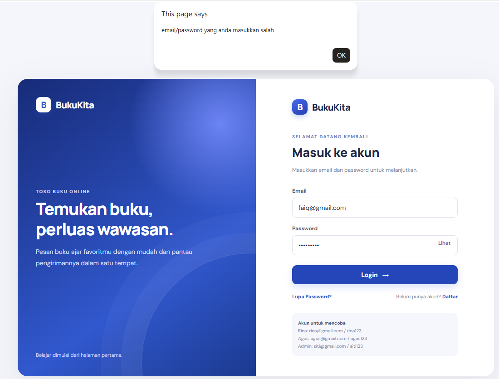
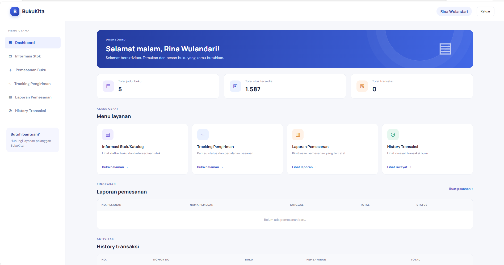
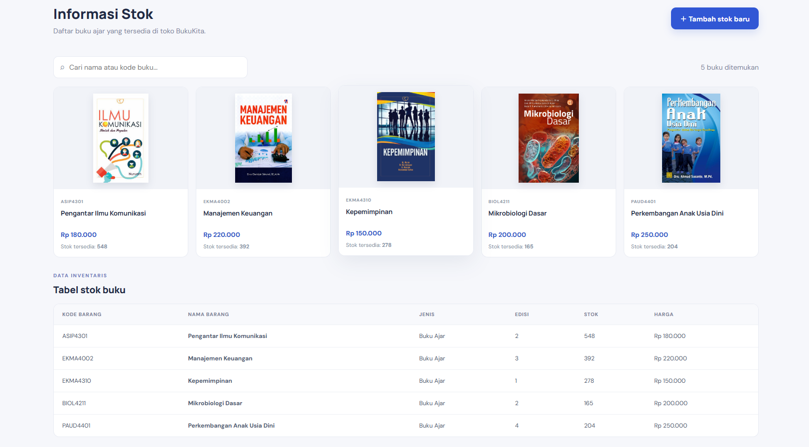
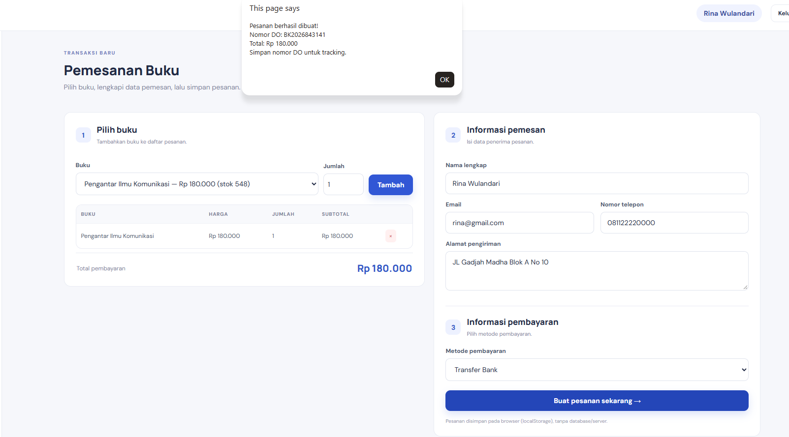
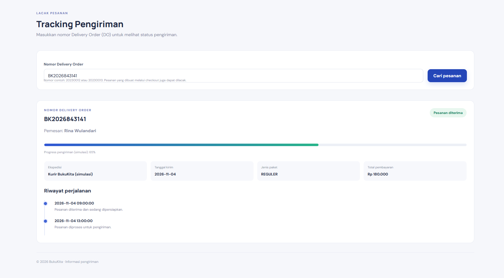

BUKUKITA - APLIKASI PEMESANAN BUKU ONLINE
UTS PEMROGRAMAN WEB 1

1. STRUKTUR FOLDER
   tugas-uts-web1/
   |-- index.html              (halaman login)
   |-- dashboard.html
   |-- stok.html
   |-- tracking.html
   |-- checkout.html
   |-- css/
   |   |-- style.css
   |-- js/
   |   |-- script.js
   |   |-- data.js
   |-- img/
       |-- pengantar_komunikasi.jpg
       |-- manajemen_keuangan.jpg
       |-- kepemimpinan.jpg
       |-- mikrobiologi.jpg
       |-- paud_perkembangan.jpeg

2. CARA MENJALANKAN
   - Ekstrak folder tugas-uts-web1.
   - Buka folder menggunakan Visual Studio Code.
   - Jalankan index.html dengan browser (disarankan menggunakan ekstensi Live Server).
   - Login memakai salah satu akun berikut:
       Rina  : rina@gmail.com / rina123
       Agus  : agus@gmail.com / agus123
       Admin : siti@gmail.com / siti123

3. FITUR
   - Login dengan validasi data pengguna dari js/data.js.
   - Modal Lupa Password dan Daftar.
   - Dashboard dengan greeting berdasarkan waktu lokal.
   - Katalog lima buku dari dataKatalogBuku dan fitur pencarian.
   - Tambah data stok menggunakan JavaScript DOM.
   - Checkout: tambah/hapus item keranjang, ubah jumlah, hitung total, validasi data pemesan dan pembayaran.
   - Pesanan disimpan menggunakan localStorage browser.
   - Tracking berdasarkan dataTracking pada data.js dan nomor DO dari transaksi checkout.
   - Laporan pemesanan dan history transaksi ditampilkan pada dashboard.

4. NOMOR DO UNTUK UJI COBA TRACKING
   - 20230012
   - 20230013
   - Nomor DO baru akan muncul setelah membuat pesanan melalui halaman checkout.

5. CATATAN
   - Aplikasi ini merupakan simulasi front-end sesuai instruksi UTS, tidak memakai server atau database.
   - Data akun pada data.js merupakan data dummy dari soal.
   - Data transaksi baru disimpan pada localStorage browser yang digunakan.
   - File sampul sudah diletakkan di folder img dan nama file disesuaikan dengan properti cover pada data.js.

Langkah 1 
Halaman Login (login.html) 
• Input: email dan password.  
• Tombol “Login”  
• Jika salah atau tidak sesuai, munculkan pop-up/alert yang berisi bahwa "email/password 
yang anda masukkan salah"  
• Terdapat tombol “Lupa Password” dan “Daftar” yang dimunculkan dalam  
• bentuk modal box/pop up 
Screenshots: 

Langkah 2 
Dashboard Menu (dashboard.html) 
• Menu utama yang terdiri atas tombol navigasi ke: 
o Informasi Stok/Katalog 
o Tracking Pengiriman 
o Laporan Pemesanan  
o Histroy Transaksi 
Screenshots:  

Langkah 3 
• Tampilkan “greeting” berdasarkan waktu local time (pagi/siang/sore). 
Informasi Stok/Katalog (stok.html) 
• Menampilkan secara dinamis dari data dummy pada data.js di variable konstanta 
dataKatalogBuku  
Screenshots:  

Langkah 4 
• Terdapat fitur untuk menambahkan baris stok baru menggunakan Javascript DOM
Halaman Pemesanan (checkout.html) 
• Menampilkan data pemesanan yang dapat ditambah/ubah. 
• Terdapat isian data informasi pemesan dan pembayaran.
Screenshots:  

Langkah 5
Informasi Pengiriman (tracking.html) 
• Input: Nomor Delivery Order 
• Ketika tombol "Cari" ditekan, tampilkan: 
o Nama Pemesan  
o Status Pengiriman (dapat disimulasikan dengan progress bar, warna, tabel, atau 
list sesuai dengan kemampuan dan kreativitas anda)  
o Detail ekspedisi, tanggal kirim, jenis paket, total pembayaran. 
Screenshots:  

